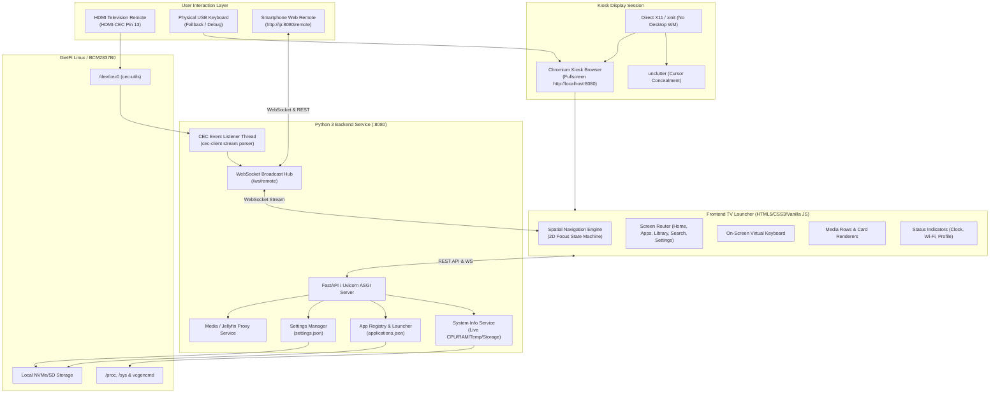
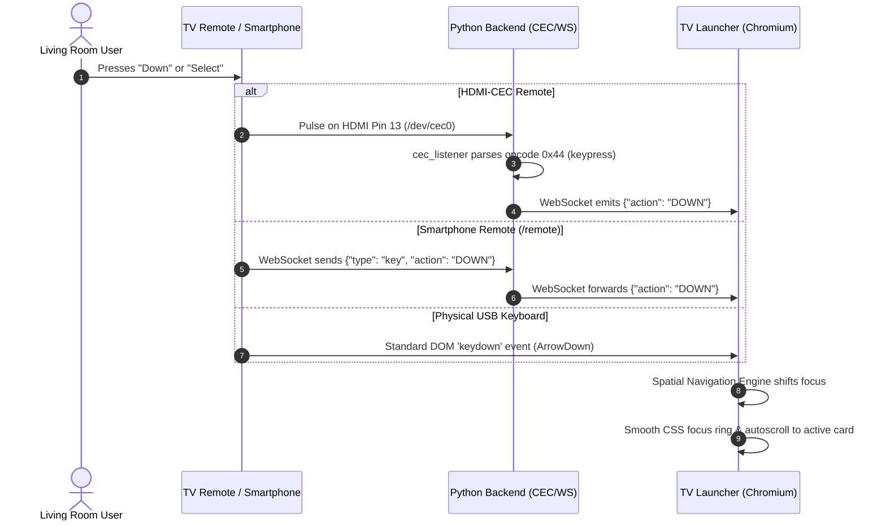
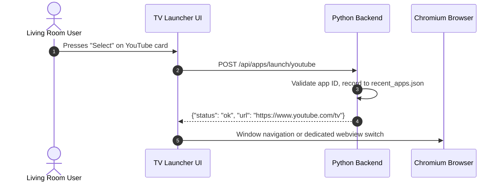

# System Architecture Specification

**Project:** Custom Google TV-Inspired Smart TV OS  
**Platform:** Raspberry Pi 3 Model B+ (DietPi Debian ARM64)  
**Execution Runtime:** Chromium Kiosk Mode + Local Python 3 Backend  

---

## 1. High-Level Architecture Diagram

---

## 2. Component Descriptions

### 2.1 Display Runtime & Kiosk Mode
* **Direct X11 Session:** Starts without window manager overhead. `startx` directly launches `unclutter` and `chromium`.
* **Unclutter:** Hides mouse cursor after 1 second of inactivity to ensure a clean, appliance-like television experience.
* **Chromium Flags:** Optimized for 1 GB RAM, disables crash notifications, update checks, pinch-to-zoom, and limits process counts.

### 2.2 Frontend TV Launcher (`frontend/`)
The frontend is built entirely using standard web technologies (**HTML5, modern CSS3, Vanilla ES6 JavaScript**) with zero external runtime frameworks or CDNs:
* **Spatial Navigation Engine (`js/navigation.js`):** Implements a predictable 2D grid/graph navigation state machine. Elements declare focus groups (`top-nav`, `featured`, `continue-watching`, `apps`, `grid`, `keyboard`). Directional inputs (Up, Down, Left, Right) compute the nearest logical target element, updates visual focus, and handles autoscrolling.
* **Screen Router (`js/router.js`):** Manages switching between primary views (`#home`, `#apps`, `#library`, `#search`, `#settings`) with smooth fade/slide transitions and focus restoration.
* **On-Screen Keyboard (`js/search.js`):** A custom 10-foot navigable keyboard for the Search screen that is fully controllable via D-pad, removing the need for a physical keyboard.
* **Smartphone Remote Client (`js/remote-client.js`):** A responsive web client served at `/remote` allowing any smartphone on the local Wi-Fi to navigate, type text, and control playback.

### 2.3 Backend Service (`backend/`)
* **FastAPI Async Engine:** Lightweight asynchronous server running under Uvicorn. Idle memory usage is ~30-35 MB RSS.
* **Application Registry (`services/app_registry.py`):** Reads and writes `config/applications.json`. Validates application IDs, handles reordering, and launches external web applications or native services while recording recently opened apps.
* **System Info Service (`services/system_info.py`):** Gathers genuine system metrics directly from Linux `/proc/stat`, `/proc/meminfo`, `/sys/class/thermal/thermal_zone0/temp`, and `os.statvfs` (with cross-platform fallbacks for development on Windows/macOS).
* **CEC Listener (`services/cec_listener.py`):** Background thread monitoring `cec-client`. Converts CEC button press codes (0x00=Select, 0x01=Up, 0x02=Down, 0x03=Left, 0x04=Right, 0x0d=Exit/Back, 0x09=Root Menu/Home) into internal remote events and broadcasts them over WebSocket.
* **WebSocket Manager (`services/websocket_manager.py`):** Maintains active connections with the TV frontend and connected mobile remotes, synchronizing key presses, typed text, and connection state.

---

## 3. Data Flow & Event Sequences

### Sequence A: Remote Key Press Event (HDMI-CEC or Phone)

### Sequence B: Application Launch Flow

---

## 4. Network & Security Architecture

1. **Port Bindings:**
   - Default port: `8080` (HTTP and WebSocket on `0.0.0.0:8080`).
   - TV Launcher runs locally on `http://localhost:8080`.
   - Smartphone remote accessed via `http://<PI_IP>:8080/remote`.
2. **Local Network Boundary:**
   - The launcher is intended strictly for local home network access (LAN).
   - No open UPnP or NAT port forwarding is enabled by default.
   - External internet access is only utilized when fetching remote media streams (YouTube, Jellyfin) or artwork. All UI components function fully offline.
