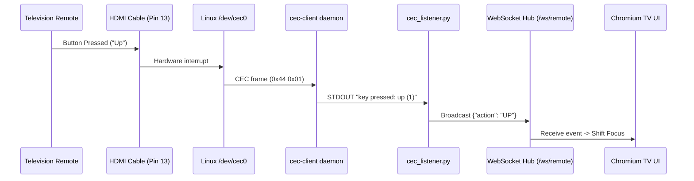

# HDMI-CEC Setup, Integration and Testing Guide

**Hardware Platform:** Raspberry Pi 3 Model B+  
**Operating System:** DietPi (Debian ARM64)  
**Interface:** HDMI 1.4 Out (Broadcom BCM2837B0 SoC Pin 13)  

---

## 1. What is HDMI-CEC?

**HDMI-CEC (Consumer Electronics Control)** is a standard feature of HDMI that allows connected multimedia devices to command and control each other over the physical HDMI cable.

On the Raspberry Pi 3B+:
* The HDMI connector includes the CEC control line on **Pin 13**.
* Unlike regular PCs which require external USB-CEC adapters (like Pulse-Eight), the Raspberry Pi’s Broadcom SoC includes **native hardware CEC support** wired directly to the HDMI port.
* The Linux kernel exposes this hardware via `/dev/cec0`.

---

## 2. Prerequisites on DietPi

Install the official CEC utilities on DietPi:
```bash
sudo apt-get update
sudo apt-get install -y cec-utils
```

### Checking CEC Hardware Detection
Run the scan command to verify communication with your television:
```bash
echo 'scan' | cec-client -s -d 1
```
Expected output:
```text
opening a connection to the CEC adapter...
requesting CEC bus information ...
CEC bus information
===================
device #0: TV
address:       0.0.0.0
active source: no
vendor:        Samsung / LG / Sony
osd string:    TV
CEC version:   1.4
power status:  on
```

If `/dev/cec0` is not found:
1. Ensure your television has CEC enabled in its settings menu (often branded under proprietary trade names):
   - Samsung: **Anynet+**
   - LG: **SimpLink**
   - Sony: **BRAVIA Sync**
   - Philips: **EasyLink**
   - Panasonic: **VIERA Link**
   - TCL / Hisense: **CEC**
2. Check `/boot/config.txt` (or `/boot/dietpi/config.txt`) to ensure HDMI hotplug is enabled:
   ```ini
   hdmi_force_hotplug=1
   hdmi_drive=2
   ```

---

## 3. Remote Control Keycode Mapping

When you press buttons on your TV remote, your TV forwards the CEC user control commands across the HDMI cable to the Raspberry Pi.

The following standard CEC opcodes (`0x44` User Control Pressed) are intercepted by our backend service (`backend/services/cec_listener.py`):

| TV Remote Button | CEC Opcode Name | CEC Keycode (Hex) | Smart TV Launcher Action |
| :--- | :--- | :--- | :--- |
| **Select / OK / Enter** | `Select` | `0x00` | Activate / Click / Open |
| **Up Arrow** | `Up` | `0x01` | Focus move UP |
| **Down Arrow** | `Down` | `0x02` | Focus move DOWN |
| **Left Arrow** | `Left` | `0x03` | Focus move LEFT |
| **Right Arrow** | `Right` | `0x04` | Focus move RIGHT |
| **Root Menu / Home** | `Root Menu` | `0x09` | Navigate to Home Screen |
| **Exit / Return / Back** | `Exit` / `Back` | `0x0d` | Navigate Back / Close modal |
| **Play** | `Play` | `0x44` | Media Play |
| **Pause** | `Pause` | `0x46` | Media Pause |
| **Stop** | `Stop` | `0x45` | Media Stop |
| **Fast Forward** | `Fast Forward` | `0x49` | Seek forward |
| **Rewind** | `Rewind` | `0x48` | Seek backward |
| **Color Button Red** | `F1 (Blue)` / `F2 (Red)` | `0x72` | Settings quick toggle |

---

## 4. How the Smart TV Launcher Intercepts CEC

The Smart TV system uses an integrated Python background service (`backend/services/cec_listener.py`):



### Standalone CLI Testing
You can manually test remote key interception directly from SSH:
```bash
cec-client | grep -E "key pressed|key released"
```
Press directional buttons on your TV remote; you will see lines like:
```text
DEBUG:   [ 12345] key pressed: up (1)
DEBUG:   [ 12500] key released: up (1)
DEBUG:   [ 13200] key pressed: select (0)
```

---

## 5. Non-CEC Fallbacks

Not all older televisions or computer monitors support HDMI-CEC. The system includes two automatic fallbacks:
1. **USB Keyboard / Air Mouse / IR Receiver:** Connect any standard USB wireless remote or keyboard. Keyboard events (`ArrowUp`, `ArrowDown`, `ArrowLeft`, `ArrowRight`, `Enter`, `Escape`, `Backspace`, `Home`) directly drive the spatial navigation engine.
2. **Smartphone Remote:** Any smartphone on the same local network can open `http://<PI_IP>:8080/remote` to obtain an instantaneous touchscreen remote with D-pad, media controls, and full keyboard typing capabilities.
